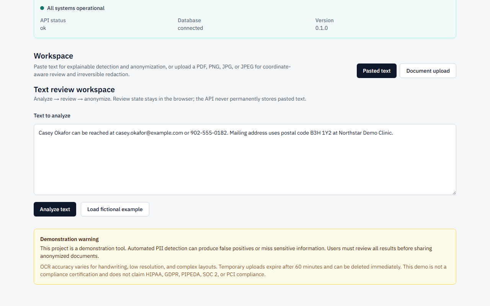
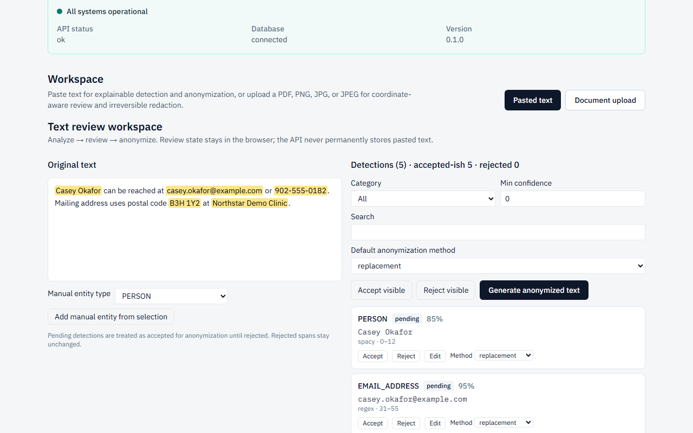
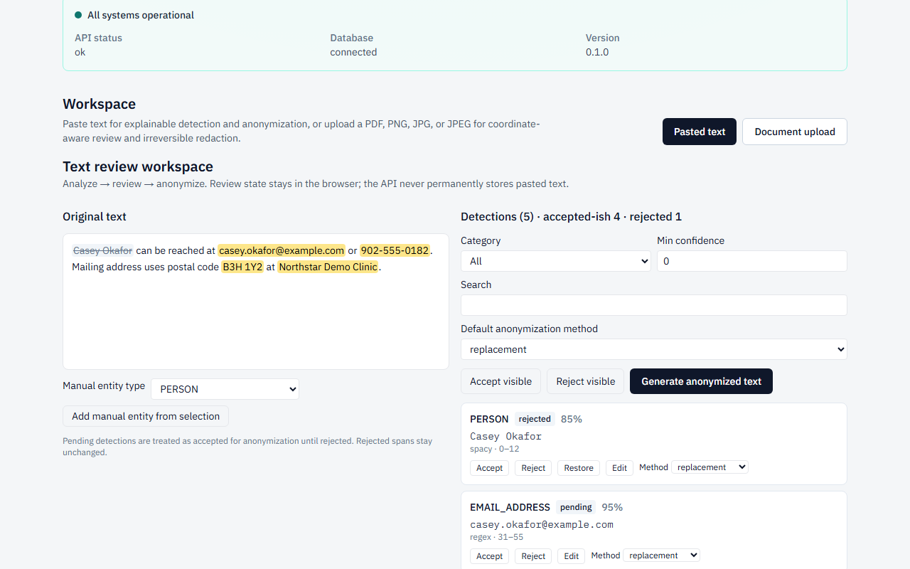
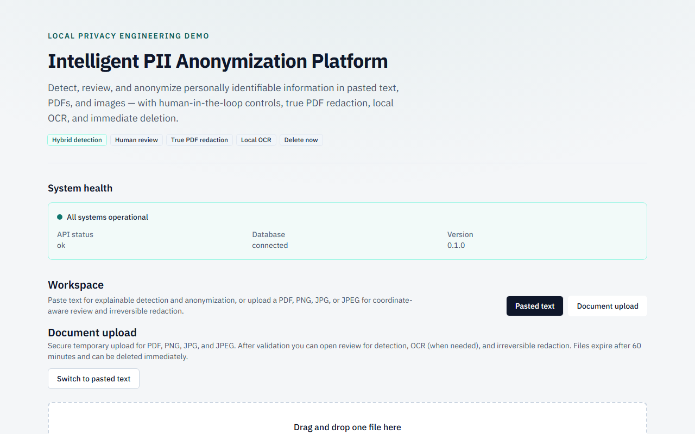
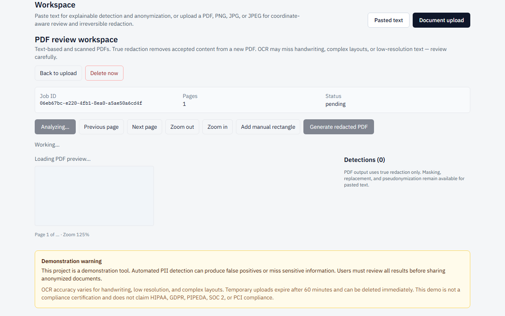
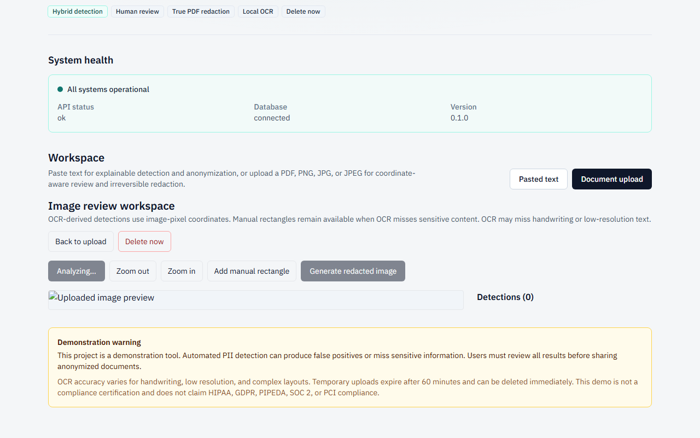
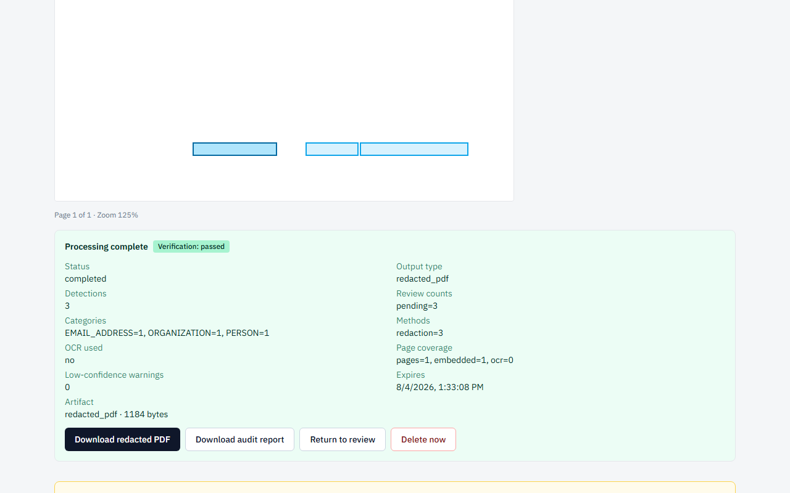
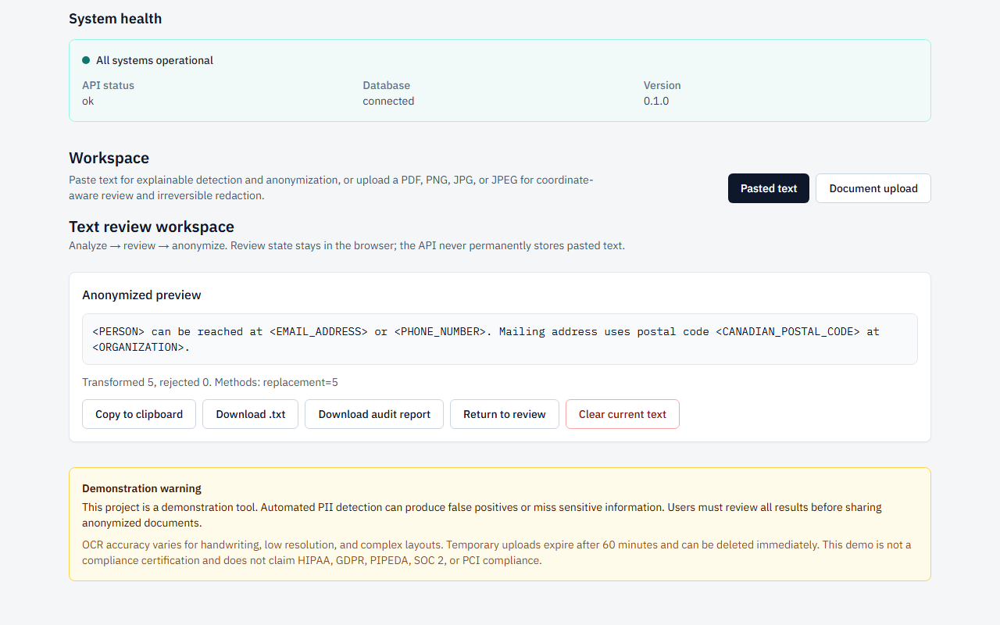
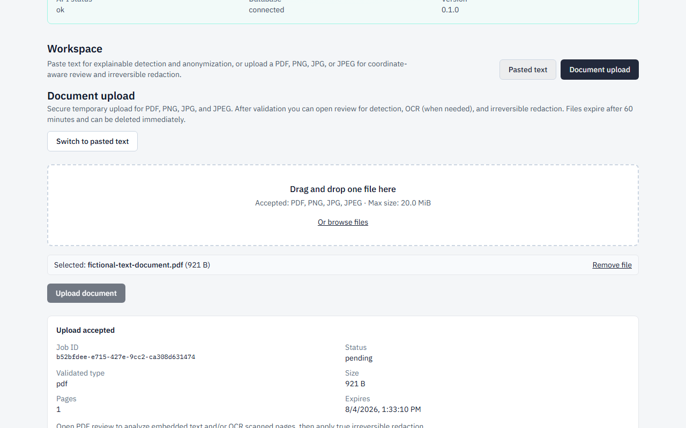
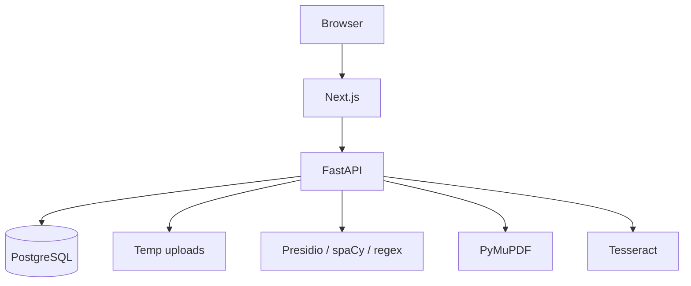

# Intelligent PII Anonymization Platform

Privacy-focused local MVP for detecting and anonymizing personally identifiable information
(PII) in pasted text, PDFs, and images — with human review, true PDF redaction, local OCR,
and immediate deletion.



> **This project is a demonstration tool. Automated PII detection can produce false positives
> or miss sensitive information. Users must review all results before sharing anonymized
> documents.**

Do **not** treat this project as guaranteed anonymization, legal compliance, medical or
financial certification, malware protection, or production readiness.

---

## Problem

Sharing documents and notes often leaks emails, phones, Canadian identifiers, and other
sensitive strings. Fully automated tools miss context; long-lived cloud pipelines expand
the privacy blast radius. This portfolio MVP shows a safer local pattern: validate →
detect → **human review** → anonymize/redact → verify → download → **delete**.

---

## Main features

- Paste text or upload PDF / PNG / JPG / JPEG
- Secure validation (extension, MIME, signature, structure limits)
- Hybrid detection: Presidio + spaCy + regex + checksums
- Canadian postal codes, phone formats, and SIN checksum support
- Human-in-the-loop accept / reject / edit / manual add
- Text methods: replacement, masking, redaction, request-scoped pseudonymization
- PDF/image method: **irreversible redaction only** (true requirement for those formats)
- Coordinate overlays for PDFs; OCR confidence for scanned pages and images
- Output verification before publishing artifacts
- Safe JSON audit report (counts/categories — not raw values)
- Delete now + 60-minute TTL expiration
- Local Tesseract OCR — no paid AI APIs, no LLM-primary detection

---

## Screenshots (fictional data only)

| Step | Image |
|------|-------|
| Home / input |  |
| Pasted-text detections |  |
| Human review |  |
| Text result |  |
| Secure upload |  |
| PDF overlays |  |
| OCR / image overlays |  |
| Redacted result |  |
| Audit summary |  |
| Delete now |  |

Regenerate screenshots (requires a running stack; **not** part of ordinary CI):

```bash
cd apps/web
npm run screenshots
```

---

## Supported inputs and categories

**Formats:** pasted text; PDF; PNG; JPG/JPEG.

**Entity categories:** `PERSON`, `EMAIL_ADDRESS`, `PHONE_NUMBER`, `STREET_ADDRESS`,
`CANADIAN_POSTAL_CODE`, `DATE_OF_BIRTH`, `CREDIT_CARD`, `CANADIAN_SIN`, `BANK_ACCOUNT`,
`IP_ADDRESS`, `URL`, `ORGANIZATION`, `LOCATION`, `MEDICAL_IDENTIFIER`, `CUSTOM_IDENTIFIER`.

Format recognition is not proof that an identifier is genuine.

---

## Architecture



Full diagrams: [docs/architecture.md](docs/architecture.md).

### Technology stack

FastAPI · PostgreSQL · Presidio · spaCy · PyMuPDF · Tesseract · OpenCV/Pillow · Next.js ·
TypeScript · Tailwind · Docker Compose · GitHub Actions.

---

## Repository structure

```text
apps/api/          FastAPI backend, Alembic, Pytest
apps/web/          Next.js frontend, Vitest, Playwright
docs/              Architecture, API, security, privacy, demo, portfolio
samples/fictional/ Synthetic demo files only
scripts/           Sample generation and live checks
docker-compose.yml Local stack
```

---

## Quick start (Docker Compose)

Clone into a **dedicated** repository (placeholder URL until you create one):

```bash
git clone <YOUR_GITHUB_REPO_URL>
cd intelligent-pii-anonymizer
```

PowerShell:

```powershell
Copy-Item .env.example .env
docker compose up --build
```

Bash:

```bash
cp .env.example .env
docker compose up --build
```

| Item | Value |
|------|-------|
| Frontend | http://localhost:3000 |
| API health | http://localhost:8000/api/v1/health |
| Published ports | `127.0.0.1:3000`, `127.0.0.1:8000` (Postgres not published) |
| First startup | Often 1–3+ minutes; API image includes spaCy + Tesseract + OpenCV (~2 GB) |
| Docker Desktop | Required on Windows (WSL2 recommended) |

Stop:

```powershell
docker compose down
```

Remove containers **and** volumes (destroys local Postgres data and temp uploads):

```powershell
# WARNING: deletes postgres_data and api_uploads volumes for this project.
docker compose down -v
```

Temporary uploads persist in the `api_uploads` volume while the stack is down unless you
remove volumes.

---

## Manual development setup

### Backend (`apps/api`)

- Python **3.12+**
- PostgreSQL 16 (or use Compose for DB only)
- System Tesseract with English data (for OCR tests)
- spaCy model: `python -m spacy download en_core_web_sm`

```bash
cd apps/api
python -m venv .venv
# Windows: .venv\Scripts\activate
source .venv/bin/activate
pip install -e ".[dev]"
python -m spacy download en_core_web_sm
alembic upgrade head
uvicorn app.main:app --reload --port 8000
pytest tests/ -v
```

### Frontend (`apps/web`)

- Node.js **22+**

```bash
cd apps/web
npm ci
npm run dev
npm run typecheck
npm run test
npm run build
npm run test:e2e
```

---

## Environment configuration

Copy `.env.example` → `.env`. Important keys: `DATABASE_URL`, `CORS_ORIGINS`,
`ALLOWED_HOSTS`, upload limits, `OCR_*`, concurrency caps. **Never commit `.env`.**

---

## Sample-data generation

```bash
python scripts/generate_fictional_samples.py
```

Writes only under `samples/fictional/` (synthetic content). See
[samples/fictional/README.md](samples/fictional/README.md).

---

## Testing

| Layer | Command |
|-------|---------|
| Backend unit/integration | `cd apps/api && pytest tests/ -v` |
| Backend skip summary | `pytest tests/ -q -rs` |
| Frontend unit | `cd apps/web && npm run test` |
| Frontend a11y smoke | `npm run test -- tests/accessibility.test.tsx` |
| Playwright | `npm run test:e2e` |
| Dependency audits | `pip-audit` / `npm audit --audit-level=critical` |
| Bandit | `bandit -r app -ll` |

Final counts are recorded in [docs/progress.md](docs/progress.md) after each full run.
Also see [docs/accessibility.md](docs/accessibility.md).

---

## Security-audit commands

```bash
cd apps/api
pip-audit --desc on
bandit -r app -ll
```

```bash
cd apps/web
npm audit --audit-level=critical
```

Accepted findings: [docs/dependency-audit.md](docs/dependency-audit.md).

---

## API examples (fictional)

Health:

```bash
curl -s http://localhost:8000/api/v1/health
```

Analyze text:

```bash
curl -s http://localhost:8000/api/v1/analyze/text ^
  -H "Content-Type: application/json" ^
  -d "{\"text\":\"Casey Okafor casey.okafor@example.com\"}"
```

Full route reference: [docs/api.md](docs/api.md).

---

## Supported workflows

1. Paste text → analyze → review → anonymize → download `.txt` + audit JSON → clear
2. Upload PDF → analyze (embedded and/or OCR) → review overlays → redact → verify →
   download → audit → delete now
3. Upload PNG/JPEG → OCR → review → irreversible redaction → download → delete now

---

## Known limitations

- Detection false positives/negatives; OCR struggles with handwriting and poor scans
- No authentication/authorization; job UUIDs are not access control
- Single-instance in-process cleanup; per-process concurrency limits only
- Validation ≠ malware scanning; delete ≠ secure erase
- API Docker image ~2 GB
- Not a compliance product (no HIPAA/GDPR/PIPEDA/SOC 2/PCI claims)

---

## Production requirements

See [docs/deployment.md](docs/deployment.md) and [docs/security.md](docs/security.md).
TLS, authn/authz, secret management, private networking, coordinated cleanup, malware
scanning, and monitoring are **not** implemented.

---

## Project status

**Phases 0–9 complete** for the local portfolio MVP. Roadmap intentionally excludes
auth SaaS features, Redis/Celery/K8s, DOCX, browser extensions, batch processing, and
LLM-primary detection.

Tracking: [docs/progress.md](docs/progress.md) · Plan: [docs/implementation-plan.md](docs/implementation-plan.md)

---

## Portfolio relevance

Resume bullets, interview talking points, and skill tags:
[docs/portfolio.md](docs/portfolio.md). Live demo script: [docs/demo-guide.md](docs/demo-guide.md).

---

## Documentation index

| Doc | Topic |
|-----|-------|
| [architecture.md](docs/architecture.md) | System diagrams |
| [api.md](docs/api.md) | HTTP API |
| [security.md](docs/security.md) | Threat model |
| [privacy.md](docs/privacy.md) | Retention & logging |
| [deployment.md](docs/deployment.md) | Production gaps |
| [accessibility.md](docs/accessibility.md) | A11y notes |
| [dependency-audit.md](docs/dependency-audit.md) | Audit findings |

---

## License

**No LICENSE file has been selected yet.** Treat the project as a private portfolio
codebase until the owner adds an explicit open-source license. See
[CONTRIBUTING.md](CONTRIBUTING.md) and [SECURITY.md](SECURITY.md).
