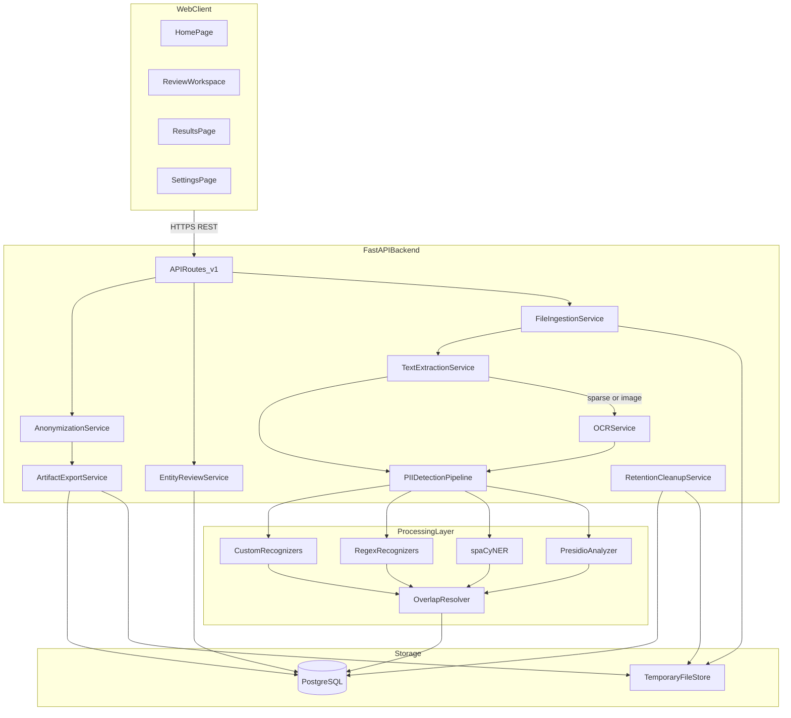
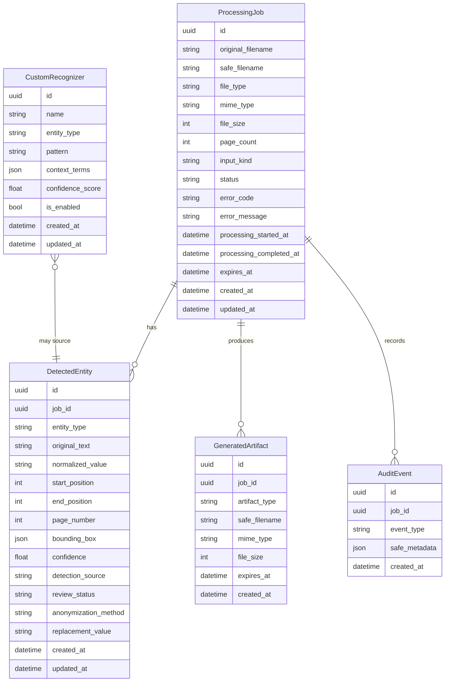
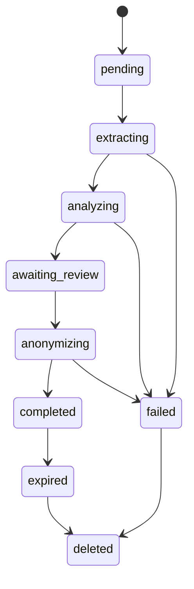
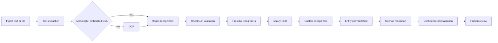
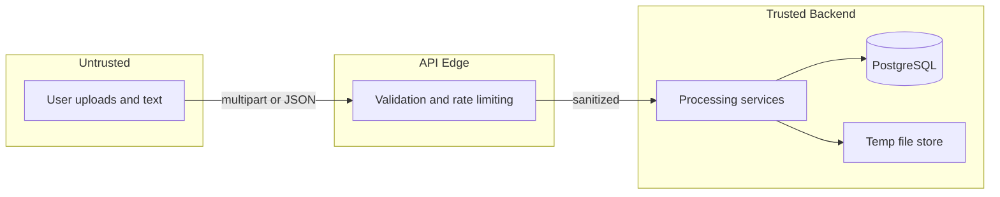

# Architecture — Intelligent PII Anonymization Platform

This document describes the system architecture, domain model, detection pipeline,
redaction approach, trust boundaries, and data-retention policy for the Intelligent
PII Anonymization Platform.

> This project is a demonstration tool. Automated PII detection can produce false
> positives or miss sensitive information. Users must review all results before
> sharing anonymized documents.

---

## 1. System context

The platform is a self-contained, privacy-focused web application that detects and
anonymizes personally identifiable information (PII) in pasted text, text-based PDFs,
scanned PDFs, and PNG/JPEG images. It runs entirely locally through Docker Compose and
requires no paid cloud AI API.



---

## 2. Component responsibilities

| Component | Responsibility |
|-----------|----------------|
| **Web client** | Next.js App Router UI: upload, two-panel review workspace, results, settings |
| **API routes (v1)** | Versioned FastAPI endpoints, request validation, typed error envelope |
| **File ingestion** | Size/MIME/signature validation, random internal filenames, temp storage |
| **Text extraction** | PyMuPDF embedded-text and coordinate extraction, page dimensions |
| **OCR service** | Tesseract OCR for images and sparse PDF pages; bounding boxes and confidence |
| **Detection pipeline** | Hybrid detection (regex → checksum → Presidio → spaCy → custom), overlap resolution, confidence normalization |
| **Entity review** | Persist detections, apply accept/reject/edit/add changes |
| **Anonymization** | Replacement, masking, redaction, pseudonymization strategies |
| **Artifact export** | Generate anonymized output files + JSON audit report |
| **Retention cleanup** | TTL expiration and manual deletion of temp files and job records |

---

## 3. Domain model

The system separates a processing job from its detected entities and generated
outputs. Complete sensitive input is never permanently stored in the database.



### Job status lifecycle



### Review status values

`pending`, `accepted`, `rejected`, `manually_added`, `edited`.

### Data-handling constraints

- `original_text` on `DetectedEntity` holds a sensitive value only for the minimal
  lifetime required to render the review UI and generate output. It is cleared or the
  whole job is deleted at expiration.
- `AuditEvent.safe_metadata` never contains raw PII values — only counts, categories,
  and timing.
- No full extracted document text, OCR text, or pseudonym mappings persist beyond a
  job's retention window.

---

## 4. Detection pipeline

The pipeline is hybrid and explainable. No large language model acts as the primary
detector; the system must work fully without one.



Ordering rationale: deterministic regex and checksum passes run first so that
structured, verifiable identifiers (credit cards, SIN) carry strong signals into
overlap resolution before statistical recognizers add broader, lower-precision spans.

### Detected-entity shape

```json
{
  "id": "entity-id",
  "entity_type": "EMAIL_ADDRESS",
  "text": "fictional.user@example.com",
  "start": 25,
  "end": 52,
  "confidence": 0.99,
  "source": "presidio",
  "page": 1,
  "bounding_box": { "x0": 100, "y0": 120, "x1": 290, "y1": 140 },
  "review_status": "pending"
}
```

### Supported entity types

`PERSON`, `EMAIL_ADDRESS`, `PHONE_NUMBER`, `STREET_ADDRESS`, `CANADIAN_POSTAL_CODE`,
`DATE_OF_BIRTH`, `CREDIT_CARD`, `CANADIAN_SIN`, `BANK_ACCOUNT`, `IP_ADDRESS`, `URL`,
`LOCATION`, `ORGANIZATION`, `MEDICAL_IDENTIFIER`, `CUSTOM_IDENTIFIER`.

Phase 2 uses `CANADIAN_POSTAL_CODE` (not a generic `POSTAL_CODE`) for Canadian formats.

### Canadian recognizers

Dedicated recognizers cover Canadian postal codes, telephone formats, Social Insurance
Numbers (with checksum validation), and optional bank transit/institution number
formats. Format recognition is never presented as proof that an identifier is genuine.
Credit-card candidates use Luhn validation; SIN candidates use the appropriate checksum
when technically suitable.

---

## 5. Overlap resolution

Different recognizers may detect overlapping character spans. Resolution is explicit
and testable, considering confidence score, entity specificity, detection source, span
length, checksum validity, and user-defined recognizer priority. A validated
`CREDIT_CARD` normally takes priority over a generic numeric entity covering the same
span. Conflicting entities are not silently discarded; enough information is recorded to
support debugging.

Unit tests cover exact duplicate spans, partial overlaps, nested entities,
equal-confidence conflicts, structured-identifier versus generic-number conflicts, and
manual user detections overriding automatic detections.

### Resolution priority (highest wins on conflict)

1. Manual user detections (`manually_added`, `edited`) override all automatic detections.
2. Checksum-validated structured identifiers (`CREDIT_CARD`, `CANADIAN_SIN`) beat
   unvalidated numeric spans on the same range.
3. Higher entity specificity (e.g. `EMAIL_ADDRESS` over `URL`) when spans overlap.
4. Higher confidence score when type and validation status are equal.
5. Longer span when confidence and specificity are equal.
6. Custom recognizer priority when configured and scores tie.
7. Detection source tie-break order: `regex_checksum` > `presidio` > `spacy` > `custom`.

Discarded entities are not silently dropped; overlap resolution records enough metadata
for debugging without persisting raw PII beyond the job retention window.

---

## 6. Anonymization strategies

| Strategy | Behavior |
|----------|----------|
| **Replacement** | Substitute a type tag, e.g. `Keenan Baird → <PERSON>` |
| **Masking** | Partially obscure while preserving shape, e.g. `f********@example.com`, `***-***-0182`, `****-****-****-1234` |
| **Redaction** | Irreversibly remove content; opaque regions for PDFs/images, block glyphs for text |
| **Pseudonymization** | Deterministic fictional replacement, consistent within a job |

Pseudonymization is deterministic within a job: the same source value receives the same
replacement, distinct values do not collide, generated values are clearly fictional, and
mappings do not persist beyond the retention window.

### Phase 3 pasted-text workflow (stateless)

For pasted text, review state lives in the browser. `POST /api/v1/anonymize/text` validates
client-supplied spans (deriving substrings server-side), resolves post-review overlaps,
applies transformations right-to-left, and discards text and pseudonym mappings when the
request completes. Rejected entities are never transformed. Manual and edited entities
outrank automatic detections; conflicting overlapping manual/edited entities return a
validation error.

Transformable review statuses: `pending`, `accepted`, `edited`, `manually_added`.
`rejected` is never transformed.

---

## 7. Redaction approach

### PDF redaction (PyMuPDF + raster rebuild)

- **Embedded-text pages:** accepted detections are mapped to PDF coordinates and applied
  with PyMuPDF true text redaction (`add_redact_annot` + `apply_redactions`) on a copy.
- **Scanned / OCR / mixed image pages:** Approach 2 — render at controlled DPI, paint
  opaque fill into raster pixels using `rotation_matrix * zoom` mapping, rebuild the page
  with only the redacted raster (no original image objects, annotations, or hidden text
  layers). Output pages are rotation-normalized to 0 while preserving visual dimensions.
- Verification re-extracts embedded text and, for pixel pages, samples fill color and
  re-OCRs when the engine is available.
- The original upload is never modified. Rejected detections remain untouched.
- Tradeoff: raster-rebuilt pages increase file size and become non-searchable images at
  the chosen DPI.

### Image redaction (Pillow / OpenCV)

For PNG/JPEG, OCR bounding boxes locate accepted detections, and irreversible filled
rectangles are drawn over sensitive regions. A new image is exported with preserved
dimensions and reasonable quality; the original input is never overwritten. Tests verify
output dimensions and changed pixel regions.

---

## 8. Trust boundaries



- The browser and all uploaded content are untrusted. Client-provided MIME types are
  never trusted alone; file signatures are validated where practical.
- The API edge enforces size/page limits, signature validation, rate limiting,
  restrictive CORS, and secure HTTP headers.
- Temp storage holds uploads and generated artifacts only inside a controlled directory
  with randomized internal filenames and path-traversal protection.

Detailed threat modeling lives in [security.md](security.md).

---

## 9. Data retention

- Uploads and artifacts are stored only in a temporary controlled directory with an
  `expires_at` TTL.
- A cleanup service removes expired temp files and associated job/entity records.
- A manual "delete now" operation immediately purges a job's files and records.
- The database stores operational metadata and minimal, short-lived sensitive values
  needed for review; it never stores full document contents, OCR text, or pseudonym
  mappings beyond the retention window.

User-facing retention and privacy details live in [privacy.md](privacy.md).

---

## 10. Technology stack

| Layer | Choices |
|-------|---------|
| Frontend | Next.js, TypeScript, Tailwind CSS, shadcn/ui, TanStack Query, React Hook Form, Zod, react-dropzone, PDF.js |
| Backend | Python 3.12, FastAPI, Pydantic v2, SQLAlchemy 2, Alembic, PostgreSQL |
| PII detection | Presidio Analyzer/Anonymizer, spaCy, regex, custom recognizers, checksum validation |
| Document processing | PyMuPDF, Pillow, OpenCV, Tesseract OCR |
| Quality | Ruff, mypy, Pytest; ESLint, Prettier, Vitest, React Testing Library, Playwright |
| Infrastructure | Docker, Docker Compose, GitHub Actions, PostgreSQL |

See [implementation-plan.md](implementation-plan.md) for phased delivery and acceptance
criteria, and [progress.md](progress.md) for status tracking.

---

## 11. Frontend pages

| Page | Purpose |
|------|---------|
| **Home** | Product explanation, supported formats, privacy statement, upload/paste entry, limitations |
| **Processing workspace** | Two-panel review: document preview (left) and entity list/controls (right) |
| **Results** | Original vs anonymized comparison, stats, downloads, delete-now |
| **Settings** | Confidence threshold, entity categories, default anonymization method, OCR language, retention, custom recognizers |

The review workspace supports accept/reject/edit/add, filtering, confidence threshold,
search, navigation to entity locations, and per-entity anonymization method overrides.

---

## 12. Error handling

API errors use a consistent typed envelope:

```json
{
  "error": {
    "code": "UNSUPPORTED_FILE_TYPE",
    "message": "Only PDF, PNG, JPG and JPEG files are supported.",
    "request_id": "request-id"
  }
}
```

Explicit error codes include: `UNSUPPORTED_FILE_TYPE`, `OVERSIZED_UPLOAD`,
`CORRUPTED_PDF`, `PASSWORD_PROTECTED_PDF`, `EMPTY_DOCUMENT`, `NO_READABLE_TEXT`,
`LOW_OCR_CONFIDENCE`, `PROCESSING_TIMEOUT`, `EXTRACTION_FAILURE`, `ANALYSIS_FAILURE`,
`REDACTION_FAILURE`, `EXPIRED_JOB`, `JOB_NOT_FOUND`, `INVALID_ENTITY_UPDATE`.
Production responses never expose stack traces, secrets, or connection strings.

---

## 13. Observability

Structured logging records safe operational metadata only: request ID, job ID, file
type, file size, page count, processing duration, detection count, entity categories,
success/failure codes. Timing measurements cover upload validation, text extraction,
OCR, PII analysis, anonymization, and export generation.

Never log: original text, detected values, uploaded file contents, pseudonym mappings,
or full extracted OCR text.

---

## 14. Configurable limits (MVP defaults)

| Limit | Default |
|-------|---------|
| Max upload size | 20 MiB |
| Max PDF pages | 50 |
| Max image pixels | 40,000,000 |
| Upload TTL | 60 minutes |
| Cleanup interval | 5 minutes |
| Default confidence threshold | 0.7 |
| Job retention TTL | Upload jobs expire after `UPLOAD_TTL_MINUTES` (Phase 4) |

All demo fixtures, tests, and README examples use obviously fictional records only.
