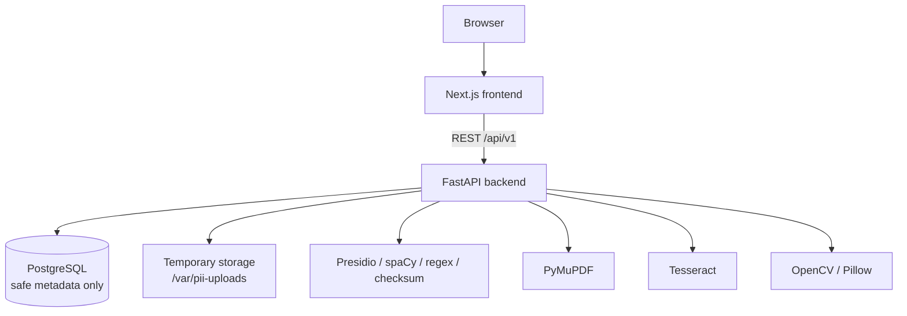
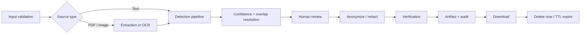
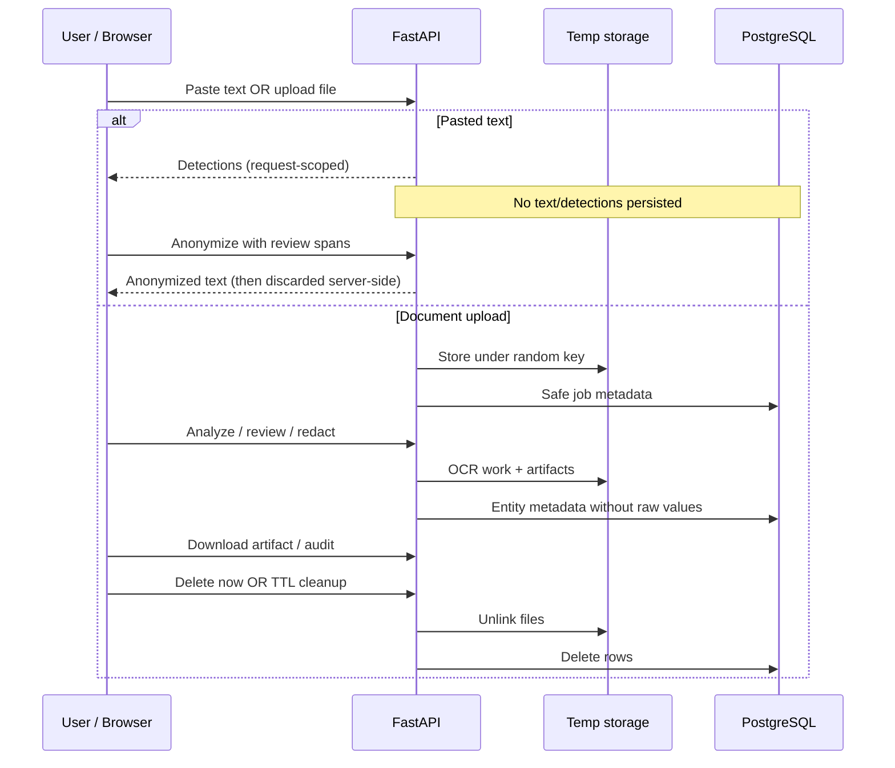
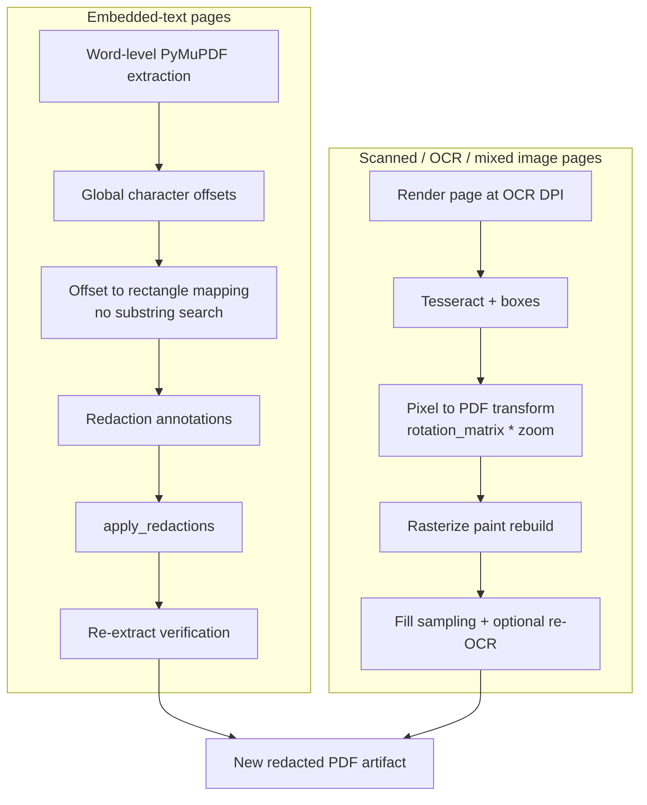
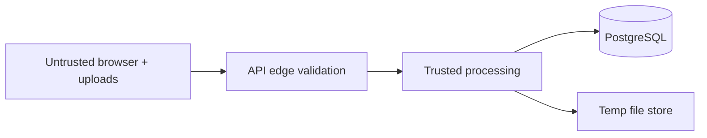

# Architecture — Intelligent PII Anonymization Platform

This document describes the **implemented** system architecture for the local MVP.
It complements [api.md](api.md), [security.md](security.md), and [privacy.md](privacy.md).

> This project is a demonstration tool. Automated PII detection can produce false
> positives or miss sensitive information. Users must review all results before
> sharing anonymized documents.

---

## 1. System context

The platform is a self-contained web application that detects and anonymizes PII in
pasted text, text-based PDFs, scanned PDFs, and PNG/JPEG images. It runs locally via
Docker Compose. There is no paid cloud AI API and no LLM-based primary detector.

**Not present in the MVP:** authentication, Redis, Celery, Kubernetes, cloud object
storage, persistent history UI, or a dedicated Settings page with server-persisted
preferences. Review filters and method choices live in the browser for the active
session.

---

## 2. Processing pipeline

### Detection ordering

1. Regex recognizers (structured patterns)
2. Checksum validation (Luhn, SIN checksum where applicable)
3. Presidio Analyzer
4. spaCy NER (`en_core_web_sm`)
5. Optional request-scoped custom regex recognizers (text analyze only)
6. Entity normalization
7. Overlap resolution + confidence normalization
8. Human review (accept / reject / edit / manual add)

---

## 3. Data lifecycle

### Fields never stored (document jobs)

- Detected PII string values
- Full extracted or OCR text
- Pseudonym mappings
- Original filenames
- Storage keys / absolute paths (not returned to clients)
- EXIF / GPS payloads on outputs

Pasted-text workflows never write the submitted text, detections, or mappings to
PostgreSQL.

---

## 4. PDF coordinate and redaction flow

- Original uploads are never modified in place.
- Rejected detections are not redacted.
- Pure embedded-text pages keep searchable text redaction; rebuilt scanned pages become
  full-page rasters (size/quality tradeoff).

---

## 5. Domain model (implemented)

| Model | Role |
|-------|------|
| `ProcessingJob` | Safe upload metadata, status, TTL, coverage JSON |
| `DetectedEntity` | Category, offsets/rects, review status, confidence, OCR flags — **not** raw values |
| `GeneratedArtifact` | Safe artifact metadata + temp path for download |

**No `AuditEvent` table.** Audit JSON is generated from existing safe metadata
(`GET /api/v1/jobs/{job_id}/audit-report`). No migration `005`.

### Job status (document)

Typical path: `pending` → analyze → `awaiting_review` → anonymize → `completed`, with
`failed` / `expired` / delete-now exits. Exact status strings are API-defined; clients
should treat unknown statuses as non-fatal display values.

### Review statuses

`pending`, `accepted`, `rejected`, `manually_added`, `edited`.

---

## 6. Component responsibilities

| Component | Responsibility |
|-----------|----------------|
| Next.js web | Home workspace: pasted text + document upload/review/results |
| FastAPI `/api/v1` | Validation, typed errors, security headers, concurrency limits |
| Ingestion | MIME/signature/size/page validation; random storage keys |
| PDF extraction | PyMuPDF words + coordinates |
| OCR | Tesseract English; OpenCV/Pillow preprocess; work-dir cleanup |
| Detection | Hybrid pipeline above |
| Anonymization | Text: replacement/masking/redaction/pseudonymize; PDF/image: redaction only |
| Results | Safe summaries, artifact download, audit JSON |
| Cleanup | In-process TTL + startup reconcile (single-instance MVP) |

---

## 7. Anonymization strategies

| Strategy | Pasted text | PDF / image |
|----------|-------------|-------------|
| Replacement | Yes (`<ENTITY_TYPE>`) | No |
| Masking | Yes (entity-aware) | No |
| Redaction | Block characters | **Required** irreversible method |
| Pseudonymization | Request-scoped | No |

---

## 8. Trust boundaries

Browser content is untrusted. Client MIME types are never trusted alone. Temp storage
is path-contained under `TEMP_UPLOAD_DIR`. See [security.md](security.md).

---

## 9. Technology stack (actual)

| Layer | Choices |
|-------|---------|
| Frontend | Next.js 15, React 19, TypeScript, Tailwind CSS, TanStack Query, PDF.js |
| Backend | Python 3.12, FastAPI, Pydantic v2, SQLAlchemy 2, Alembic, PostgreSQL 16 |
| Detection | Presidio Analyzer, spaCy, regex, checksums, optional custom regex |
| Documents | PyMuPDF, Pillow, OpenCV headless, Tesseract OCR |
| Quality | Ruff, mypy, Pytest, Hypothesis; ESLint, Prettier, Vitest, Playwright, axe |
| Infra | Docker Compose, GitHub Actions, Dependabot |

---

## 10. Frontend surfaces

| Surface | Purpose |
|---------|---------|
| Home | Branding, health, demonstration warning |
| Pasted-text workspace | Analyze → review → anonymize → download |
| Document upload | Validated temporary upload + delete now |
| PDF review | Overlays, entity controls, true redaction |
| Image review | OCR overlays, irreversible pixel redaction |
| Result panel | Summary, downloads, audit, delete now |

There is **no** separate authenticated Settings app route. Confidence filters and default
methods are client-side controls inside the review workspaces.

---

## 11. Configurable limits (defaults)

| Limit | Default |
|-------|---------|
| Max text length | 50,000 |
| Max upload size | 20 MiB |
| Max PDF pages | 50 |
| Max image pixels | 40,000,000 |
| Upload TTL | 60 minutes |
| Cleanup interval | 5 minutes |
| OCR max pages | 20 |
| OCR DPI | 200 |
| OCR language | `eng` |

---

## 12. Observability

Structured logs record safe operational metadata only (request ID, counts, durations,
categories, error codes). Never log original text, detected values, OCR text, paths,
storage keys, or pseudonym mappings.
